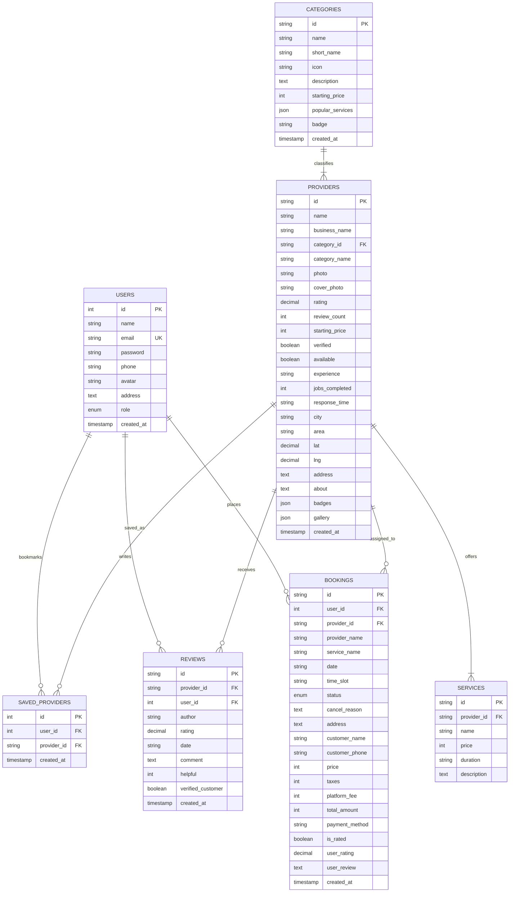

npm ru# Fixify Backend API (Node.js + Express + MySQL)

Production-grade RESTful API backend for **Fixify** — an on-demand local home-services marketplace. Built using pure **Node.js, Express, mysql2, JWT, and plain SQL queries** (no ORMs) for transparency and clarity during technical evaluations and viva examinations.

---

## 🏛️ System Architecture

```
[ React 18 + Vite Frontend ] :5173
              │
              ▼  (HTTP / JSON with JWT Bearer Token)
     [ Vite Proxy / CORS ]
              │
              ▼
[ Express REST API Server ] :5000
    ├── Auth Routes & JWT Middleware
    ├── Provider Controller (SQL Haversine Formula)
    ├── Bookings & Reviews Controllers
    └── Connection Pool (mysql2/promise)
              │
              ▼
  [ MySQL 8.x / MariaDB Database ] :3306 (fixify_db)
    ├── users
    ├── categories
    ├── providers
    ├── services
    ├── reviews
    ├── bookings
    └── saved_providers
```

---

## 📊 Entity-Relationship (ER) Diagram Description

### Visual Mermaid Diagram


### Relationships & Cardinalities:
1. **`categories` to `providers` (1 : N)**: One category contains multiple technicians. `ON DELETE CASCADE` ensures referential integrity.
2. **`providers` to `services` (1 : N)**: Each provider defines multiple service packages with individualized prices and durations.
3. **`providers` to `reviews` (1 : N)**: Each technician accumulates multiple verified customer ratings.
4. **`users` to `bookings` (1 : N)**: A registered customer can schedule multiple service appointments. `user_id` is nullable (`ON DELETE SET NULL`) so historical service records are preserved.
5. **`users` to `saved_providers` (1 : N) & `providers` to `saved_providers` (1 : N)**: Represents a Many-to-Many (`M:N`) bookmarking relationship with a unique compound key `(user_id, provider_id)`.

---

## 🚀 Quick Setup & Installation Guide

### Prerequisites
- **Node.js** (v18.0 or higher) & **npm**
- **MySQL Server** (MySQL 8.x, MariaDB, or XAMPP / WampServer) running on port `3306`.

---

### Step 1: Configure Environment Variables
Inside the `server/` directory, create or check `.env`:
```env
PORT=5000
NODE_ENV=development

# MySQL Database Configuration
DB_HOST=localhost
DB_PORT=3306
DB_USER=root
DB_PASSWORD=
DB_NAME=fixify_db

# JWT Authentication Secret
JWT_SECRET=fixify_super_secret_jwt_key_2026_change_in_production
JWT_EXPIRES_IN=7d

# Frontend Origin for CORS
CLIENT_URL=http://localhost:5173
```
*(If using XAMPP, default `DB_USER` is `root` and `DB_PASSWORD` is blank).*

---

### Step 2: Install Server Dependencies
Open a terminal in the root directory:
```bash
cd server
npm install
```

---

### Step 3: Initialize & Seed the MySQL Database
You can initialize the database using either **Method A (Automatic)** or **Method B (Manual CLI/GUI)**:

#### Method A: Automatic Seed Script (Recommended)
Run the automated script that executes `schema.sql` and `seed.sql`:
```bash
npm run seed
```
*Output:*
```
🔄 Initializing Fixify MySQL Database...
✅ Connected to MySQL server at localhost:3306
📄 Executing schema.sql (creating database & tables)...
✅ Tables created successfully!
🌱 Executing seed.sql (inserting providers, services, reviews)...
✅ Database seeded successfully with 31+ authentic technicians!
📊 Database Status Summary:
   - Users:     3
   - Providers: 31
   - Services:  76
   - Reviews:   41
```

#### Method B: Manual Import via MySQL CLI
```bash
mysql -u root -p < schema.sql
mysql -u root -p < seed.sql
```
*(Or import `schema.sql` followed by `seed.sql` into **phpMyAdmin**).*

---

### Step 4: Start the Backend Server
```bash
# Development mode with auto-reload:
npm run dev

# Or standard production mode:
npm start
```
The server will start on `http://localhost:5000`. Test health:
```bash
curl http://localhost:5000/api/health
```

---

### Step 5: Start the Frontend Application
In a separate terminal window, start the React + Vite frontend:
```bash
# In the project root directory
npm run dev
```
Open **`http://localhost:5173`** in your browser. All API calls to `/api/*` are automatically proxied to `http://localhost:5000`.

---

## 📡 API Reference & Endpoints

### 1. Authentication (`/api/auth`)

| Method | Endpoint | Access | Description |
|---|---|---|---|
| `POST` | `/api/auth/signup` | Public | Register a new customer (`name`, `email`, `password`, `phone`, `address`) |
| `POST` | `/api/auth/login` | Public | Authenticate user & return JWT token |
| `GET` | `/api/auth/me` | Protected (JWT) | Get currently authenticated user's profile |

#### Seeded Test Credentials:
- **Demo Customer**: `aditya.k@fixify.in` / Password: `password123`
- **Admin**: `admin@fixify.in` / Password: `admin123`
- **Customer 2**: `pooja.s@fixify.in` / Password: `password123`

---

### 2. Providers & Search (`/api/providers`)

| Method | Endpoint | Access | Description |
|---|---|---|---|
| `GET` | `/api/providers` | Public | Search and filter technicians with Haversine distance |
| `GET` | `/api/providers/:id` | Public | Full provider profile with services, reviews, and distance |
| `POST` | `/api/providers/:id/reviews` | Optional Auth | Submit a review and recalculate provider aggregate rating |

#### Supported Query Parameters for `GET /api/providers`:
- `category` (e.g., `ac-repair`, `plumber`, `electrician`, `carpenter`)
- `search` / `searchQuery` (searches technician name, business name, category, area, city, and services)
- `lat` & `lng` (user GPS coordinates; triggers SQL Haversine calculation)
- `maxDistance` (radius in kilometers, e.g. `10`)
- `minRating` (e.g. `4.5`)
- `minPrice` & `maxPrice` (e.g. `minPrice=200&maxPrice=800`)
- `verified=true`
- `available=true`
- `sort` (`recommended`, `nearest`, `price-asc`, `rating-desc`, `reviews-desc`)

---

### 3. Bookings (`/api/bookings`)

| Method | Endpoint | Access | Description |
|---|---|---|---|
| `POST` | `/api/bookings` | Optional Auth | Create an appointment (generates `FIX-XXXXX` reference ID) |
| `GET` | `/api/bookings` | Optional Auth | Retrieve user's bookings list |
| `PATCH` | `/api/bookings/:id` | Optional Auth | Cancel booking (`status: Cancelled`), Reschedule (`date`, `timeSlot`), or Rate service |

---

### 4. Saved Providers (`/api/saved`)

| Method | Endpoint | Access | Description |
|---|---|---|---|
| `GET` | `/api/saved` | Optional Auth | Retrieve list of saved provider IDs |
| `POST` | `/api/saved/:providerId` | Optional Auth | Bookmark / save a technician |
| `DELETE` | `/api/saved/:providerId` | Optional Auth | Remove technician from favorites |

---

### 5. Categories (`/api/categories`)

| Method | Endpoint | Access | Description |
|---|---|---|---|
| `GET` | `/api/categories` | Public | List all 8 service categories with starting prices and badges |

---

## 🧪 Comprehensive API Test Checklist (cURL)

Copy and execute these commands in your terminal or import into Postman:

### 1. Health Check
```bash
curl -X GET http://localhost:5000/api/health
```

### 2. User Registration (Signup)
```bash
curl -X POST http://localhost:5000/api/auth/signup \
  -H "Content-Type: application/json" \
  -d '{
    "name": "Rohan Deshmukh",
    "email": "rohan.d@example.com",
    "password": "password123",
    "phone": "+91 98220 99887",
    "address": "Kothrud, Pune"
  }'
```

### 3. User Login
```bash
curl -X POST http://localhost:5000/api/auth/login \
  -H "Content-Type: application/json" \
  -d '{
    "email": "aditya.k@fixify.in",
    "password": "password123"
  }'
```

### 4. Search Providers with GPS Proximity (Haversine Formula)
*(Kothrud, Pune coordinates: lat 18.5074, lng 73.8077)*
```bash
curl -X GET "http://localhost:5000/api/providers?lat=18.5074&lng=73.8077&maxDistance=15&sort=nearest"
```

### 5. Filter AC Technicians with Min Rating 4.8
```bash
curl -X GET "http://localhost:5000/api/providers?category=ac-repair&minRating=4.8"
```

### 6. Get Provider Profile by ID
```bash
curl -X GET "http://localhost:5000/api/providers/prov-ac-1?lat=18.5074&lng=73.8077"
```

### 7. Submit a Customer Review
```bash
curl -X POST http://localhost:5000/api/providers/prov-ac-1/reviews \
  -H "Content-Type: application/json" \
  -d '{
    "author": "Ananya Joshi",
    "rating": 5,
    "comment": "Exceptional service! Very polite and cleaned everything before leaving."
  }'
```

### 8. Create a New Booking
```bash
curl -X POST http://localhost:5000/api/bookings \
  -H "Content-Type: application/json" \
  -d '{
    "providerId": "prov-ac-1",
    "providerName": "Santosh Shinde",
    "serviceName": "AC Jet Deep Clean Service",
    "date": "2026-11-10",
    "timeSlot": "11:00 AM - 01:00 PM",
    "address": "Flat 302, Mayur Colony, Kothrud, Pune",
    "customerName": "Rohan Deshmukh",
    "customerPhone": "+91 98220 99887",
    "price": 499,
    "taxes": 89,
    "platformFee": 49,
    "totalAmount": 637,
    "paymentMethod": "Pay After Service (Cash / UPI)"
  }'
```

### 9. Cancel a Booking
```bash
curl -X PATCH http://localhost:5000/api/bookings/FIX-84920 \
  -H "Content-Type: application/json" \
  -d '{
    "status": "Cancelled",
    "cancelReason": "Out of town on service day"
  }'
```

### 10. Bookmark a Provider
```bash
curl -X POST http://localhost:5000/api/saved/prov-plumb-1
```

---

## 🎓 Academic / Viva Examination Q&A

### Q1: Why did you use Plain SQL instead of an ORM like Prisma or Sequelize?
> **Answer**:
> 1. **Complete query control**: Complex queries like the mathematical Haversine spherical distance formula, composite ranking equations, and custom aggregate updates are straightforward and performant in pure SQL without ORM translation overhead.
> 2. **Conceptual transparency**: Writing raw queries demonstrates a thorough understanding of relational database principles, indexing, subqueries, and table joins.
> 3. **Minimal dependencies**: Reduces package bloat, eliminates compilation issues, and makes execution predictable.

### Q2: How does the SQL Haversine formula work in Fixify?
> **Answer**:
> The Haversine formula calculates the great-circle distance between two points on the surface of a sphere using latitude and longitude:
>
> $$d = 2R \arcsin\left(\sqrt{\sin^2\left(\frac{\Delta\phi}{2}\right) + \cos(\phi_1)\cos(\phi_2)\sin^2\left(\frac{\Delta\lambda}{2}\right)}\right)$$
>
> In our SQL query, we use the spherical law of cosines ($R \approx 6371\text{ km}$):
> ```sql
> (6371 * acos(
>   LEAST(1.0, GREATEST(-1.0,
>     cos(radians(?)) * cos(radians(p.lat)) * cos(radians(p.lng) - radians(?)) +
>     sin(radians(?)) * sin(radians(p.lat))
>   ))
> )) AS distance
> ```
> `LEAST(1.0, GREATEST(-1.0, ...))` prevents floating-point rounding errors where the inner term might exceed 1.0 and cause `acos()` to return `NULL`. We then filter by radius using the `HAVING distance <= ?` clause.

### Q3: How is database security handled?
> **Answer**:
> 1. **SQL Injection Prevention**: All queries use parameterized statements (`?` placeholders) with `mysql2`, ensuring user inputs are treated as literal values rather than executable code.
> 2. **Password Hashing**: User passwords are encrypted using `bcryptjs` with 10 salt rounds before persistence.
> 3. **Token-based Authentication**: Secure stateless authentication via JSON Web Tokens (JWT) signed with a private secret and expiration time.
> 4. **Input Sanitization & Normalization**: Emails are lowercase-trimmed, prices and ratings are bounds-checked.

